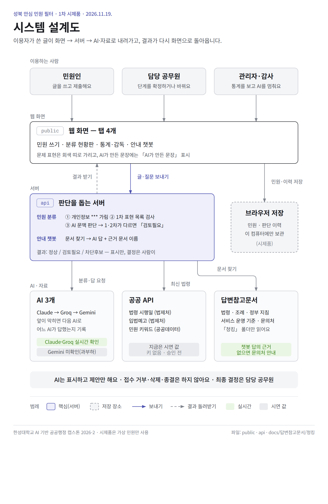

# 성북 안심 민원 필터

**AI가 표시하고, 사람이 결정하는 온라인 민원 글 보호·순화 서비스**

성북구청 누리집에 들어오는 글 민원을 AI가 **정상 / 검토필요 / 차단후보**로 표시합니다. 담당 공무원은 욕설·협박을 원문 그대로 읽지 않고도 민원의 요구를 처리할 수 있습니다. 민원인은 언제든 글을 그대로 제출할 수 있고, 최종 결정은 담당 공무원이 합니다.

> 한성대학교 「AI 기반 공공행정 캡스톤」 2026-2학기 시제품입니다. 모든 민원은 **[가상 예시]**이며, 실제 민원과 개인정보는 쓰지 않습니다.

## 시스템 설계도



인쇄용 PDF: [docs/시스템설계도.pdf](docs/시스템설계도.pdf)

## 화면 구성

| 탭 | 누가 쓰나 | 하는 일 |
|---|---|---|
| 민원인 | 민원인 | 글을 쓰고 제출합니다. 차단후보로 보이면 안내 창에서 「제안대로 고치기 / 직접 고치기 / 그대로 제출」 중 하나를 고릅니다 |
| 담당 공무원 | 담당 공무원 | 단계별로 민원을 봅니다. 순화본과 핵심 요약을 먼저 보고, 필요하면 [원문 보기]를 누릅니다. 단계를 확정하거나 바꿉니다 |
| 관리자·감사 | 부서 관리자·감사 담당 | 단계별 건수, 판단 변경률, 판단 이력을 봅니다. AI 표시를 잠시 멈출 수 있습니다(수동 모드) |
| 안내 챗봇 | 모두 | 서비스에 대해 묻습니다. `docs/답변참고문서`만 근거로 답하고, 근거 문서 이름을 붙입니다 |

## 민원 한 건이 거치는 과정

1. 이름·전화번호·주소 같은 개인정보를 `***`로 가립니다(AI에 보내기 전).
2. 1차로 표현 목록과 맞춰 봅니다.
3. 2차로 AI가 문맥을 판단하고, 순화본과 요약을 만듭니다.
4. 1차와 2차 판단이 다르면 **검토필요**로 보냅니다.

AI는 **Claude → Groq → Gemini** 순서로 부릅니다. 앞의 AI가 막히면 다음 AI로 넘어가고, 어느 AI가 답했는지 기록합니다.

## 하지 않는 것

- 접수 거부, 민원 삭제, 자동 종결
- 제출 횟수·IP로 글 거르기, 특정 민원인 추적·제재

## 폴더

| 폴더·파일 | 내용 |
|---|---|
| `public/` | 이용자가 보는 화면 |
| `api/` | AI와 공공 API를 부르는 서버 |
| `docs/답변참고문서/청킹/` | 챗봇이 읽는 근거 문서 |
| `server.js` | 내 컴퓨터에서 실행하는 파일 |
| `vercel.json` | 배포 설정 |

## 내 컴퓨터에서 실행하기

1. Node.js 22 이상을 설치합니다.
2. `.env` 파일에 키를 넣습니다: `CLAUDE_API_KEY`, `GROQ_API_KEY`, `GEMINI_API_KEY` (선택: `LAW_OC`, `LAWMAKING_OC`, `DATA_GO_KR_KEY`)
3. 아래 명령을 실행하고 http://localhost:3000 을 엽니다.

```bash
npm start
```

`.env`는 깃허브에 올리지 않습니다.

## 지금 상태 (2026.11.19.)

| 항목 | 상태 |
|---|---|
| Claude · Groq | 실시간 동작 확인 |
| Gemini | 미확인(시험 때 과부하) |
| 법령 시행일 · 입법예고 · 민원 키워드 | 시연 값(키 없음 · 승인 전) |
| 저장 | 브라우저에만 저장(시제품) |
